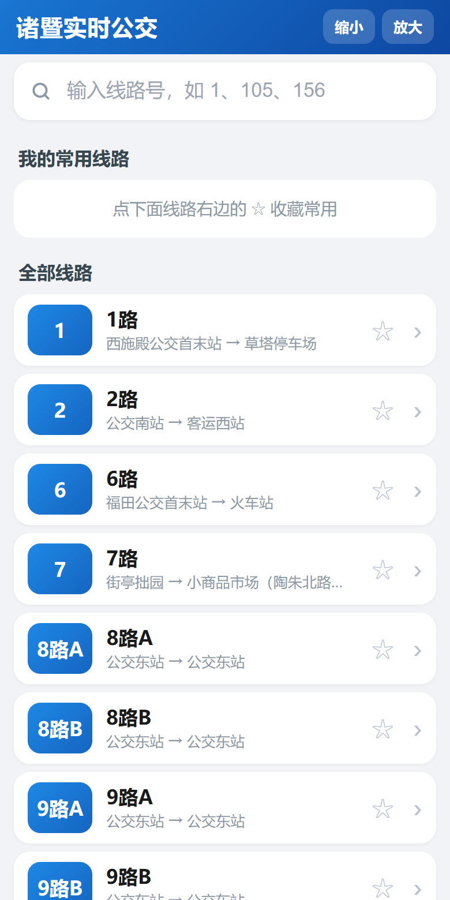
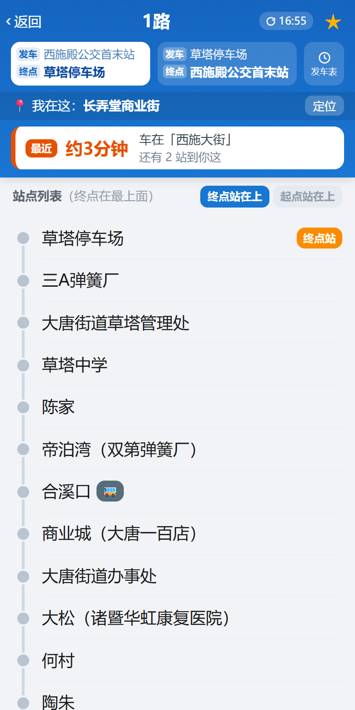
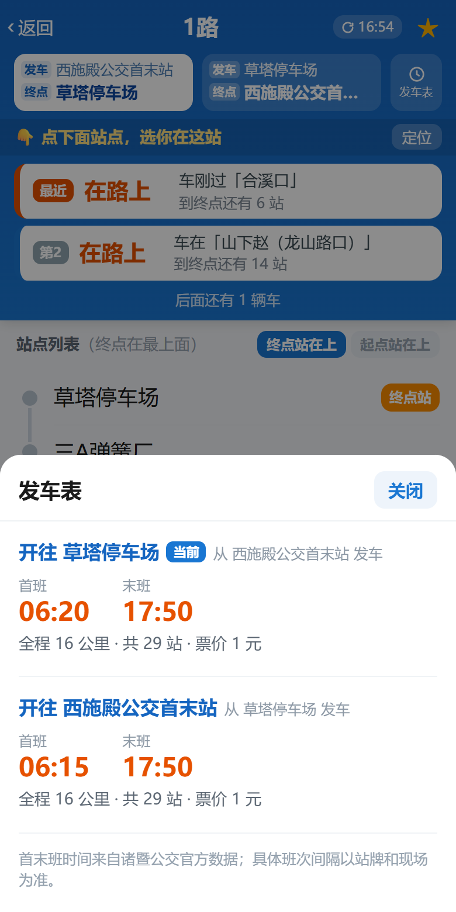

# 诸暨实时公交 · Zhuji Bus Live

> 给诸暨人（尤其是老人）用的**免登录**实时公交查询页。打开就能查，不用浙里办、不用支付宝、不用注册。

**在线使用：<https://byazlle.github.io/zhuji-bus-live/>**

**安卓安装包：[下载 APK](https://github.com/byazlle/zhuji-bus-live/releases/latest)**（Android 5.0+，装完点开即用）

<p align="center">
  
  
  
</p>

---

## 为什么做这个

诸暨公交只能在"浙里办"里查，老人没有支付宝、也不会登录，出门前想知道"下一班还有几分钟"非常麻烦。

这个页面做的事很简单：**直连诸暨市公交的公开数据接口，不需要任何登录，输入线路号就能看到下一班车还有几分钟到你要坐的那一站。**

## 功能

| 功能 | 说明 |
|---|---|
| 免登录 | 直接调诸暨公交官方接口，无需账号 |
| 线路搜索 | 内置 395 条线路（含城乡公交、夜间专线），输入 `1`、`105A` 即可 |
| 常用线路 | 收藏上限 30 条，存在本机；`管理` 可批量删除 |
| 方向切换 | 不用"上行/下行"，直接写「发车 起点站 / 终点 终点站」 |
| 站点排序 | 「终点站在上 / 起点站在上」一键切换，偏好会记住 |
| 我在哪一站 | 自动定位选最近站，或直接点站点手动选 |
| 车辆信息 | 车现在到哪一站、还有几站到你这、大约几分钟 |
| 只显示没开过的车 | 已经过站的车自动隐藏；最近的那辆标「最近」 |
| 分级自动刷新 | 1 站内 10 秒、2 站 15 秒、3 站以上 60 秒；切后台自动暂停 |
| 发车表 | 两个方向的首班 / 末班 / 全程公里 / 站数 / 票价 |
| 字号调节 | 90% ~ 136% 五档，老人看得清；布局不散 |
| 安卓 APK | 单文件 WebView 壳，装完点开就用（[下载](https://github.com/byazlle/zhuji-bus-live/releases/latest) / `dist/` 内也有） |

## 界面

- 大字大按钮、高对比度，**站点列表 18px、车辆时间 19px**
- 车辆卡片吸顶，滚动看站点时一直能看到"下一班还有几分钟"
- 车辆卡片吸顶区约占屏幕 25%，尽量把空间留给站点列表

## 技术说明

- **纯静态单文件**：`index.html` 内联了全部 CSS/JS/线路数据，无框架、无构建、无外部依赖，双击即可打开
- **接口直连**：`POST https://zjcx.zhuji.gov.cn:9443`，`Content-Type: application/json`
  - 该接口返回 `Access-Control-Allow-Origin: *`，所以浏览器和 WebView 都能直接跨域调用，**不需要自建后端代理**
  - 请求体结构 `{ "h": {固定请求头}, "b": {业务参数} }`，详见 [docs/API-接口文档.md](docs/API-接口文档.md)
- **本地存储**：收藏、上次选站、字号、站点排序都存 `localStorage`，不上传任何数据
- **定位**：调用浏览器 `navigator.geolocation`，坐标只在本地换算"最近站点"，**不上传、不记录**
- **兼容性**：Android 5.0+ WebView / 微信内置浏览器 / Chrome / Safari；无 `fetch` 的老内核自动降级到 `XMLHttpRequest`

### 关键实现点（踩过的坑）

1. `vehicleOrder` 是**车已经开过的那一站**（1 起），不是"下一站"；`distance` 是到**下一站**的米数。
   所以 `还有几站 = 我的站序 − vehicleOrder`，等于 0 且已走远就判定为"刚开走"并隐藏。
2. 站点列表默认终点在最上面，车是往上开的，所以方向卡片**不画箭头**，直接写清「发车 / 终点」。
3. 吸顶不要写死 `top: 105px`，把「顶栏 + 方向 + 我在哪站 + 车辆卡片」放进**同一个 sticky 容器**（`top: 0`）才不会遮挡。
4. `body { overflow-x: hidden }` 会让 body 变成滚动容器，直接破坏 `position: sticky` 和整页滚动，别加。
5. 字号缩放用 `zoom`（布局级缩放，文字重新栅格化，清晰），不要用 `transform: scale`（会糊）。

## 目录结构

```
.
├── index.html                 # 在线页面（GitHub Pages 入口，与 web/index.html 同源）
├── web/index.html             # 开发源文件
├── android/                   # 安卓 WebView 壳（手写工程，不依赖 Gradle）
│   ├── src/com/zjbus/live/MainActivity.java
│   ├── res/                   # 图标与主题
│   ├── AndroidManifest.xml
│   ├── build.sh               # 一条命令出 APK
│   └── make_icons.py          # 纯 Python 生成启动图标
├── dist/诸暨实时公交.apk       # 已签名安装包
├── docs/
│   ├── API-接口文档.md         # 接口字段、实测结论
│   └── 项目说明与迭代记录.md    # 需求、修复清单、迭代历史
├── assets/                    # 截图
└── scripts/sync-web.sh        # 把 web/index.html 同步到根目录
```

## 本地运行

```bash
# 方式一：直接双击 index.html（file:// 也能正常调接口）

# 方式二：起个本地服务
cd web && python -m http.server 8080
# 浏览器打开 http://127.0.0.1:8080
```

修改页面请改 **`web/index.html`**，然后同步到根目录：

```bash
bash scripts/sync-web.sh
```

## 打包安卓 APK

工程是**手写的最小 WebView 壳**，不依赖 Android Studio / Gradle，只需要 JDK 17 + Android SDK（build-tools 34 + platform 34）。

```bash
export JAVA_HOME=/path/to/jdk-17
export ANDROID_HOME=/path/to/android-sdk
bash android/build.sh
# 产物：dist/诸暨实时公交.apk
```

构建流程：`aapt2 compile/link → javac → d8 → 打包 classes.dex → zipalign → apksigner`。
首次构建会在 `android/` 下生成自签名证书 `release.keystore`（已加入 .gitignore，请自行备份，升级覆盖安装需要同一份证书）。

APK 权限只有：网络、网络状态、定位（点「定位」时才会申请）。

## 数据来源与免责声明

- 数据来自诸暨市公交官方查询服务（`zjcx.zhuji.gov.cn`），本站只做展示
- 车辆位置为车载 GPS 上报，存在几十米误差与 10~30 秒延迟
- 首末班时间、票价来自官方接口，**班次间隔以站牌和现场为准**
- 本项目为个人自用工具，与诸暨市公交公司无隶属关系；如官方接口调整，功能可能失效

## License

[MIT](LICENSE)
